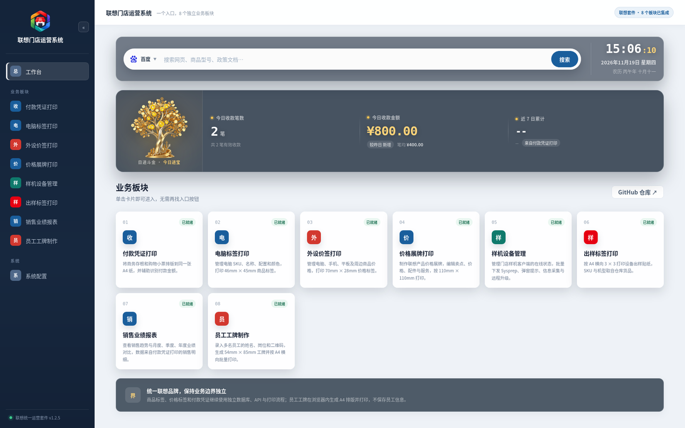
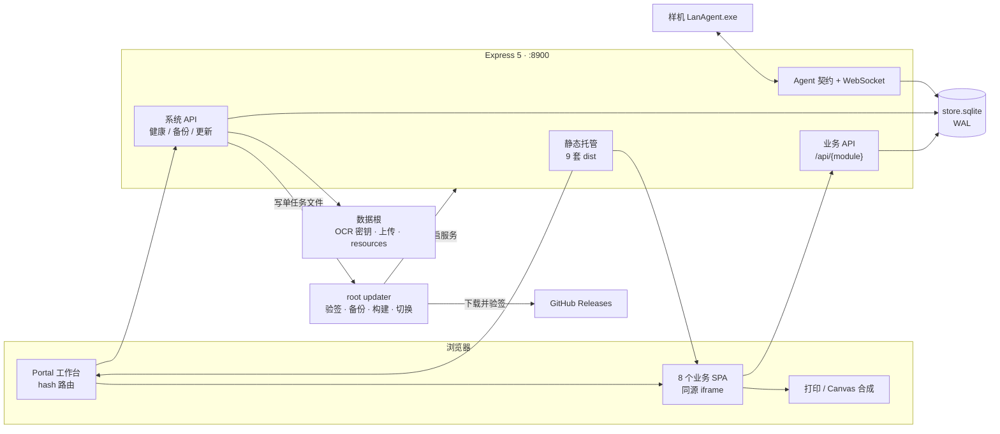

# 联想门店运营系统

把门店里分散的打印与查询工具收进一个品牌、一个入口、一个服务进程：电脑标签、外设价签、价格展牌、付款凭证、出样标签、员工工牌、销售业绩报表、样机设备管理，共 **8 个业务板块**，统一跑在 `http://localhost:8900`。

Node.js `22.21.1` · Vue 3 · Express 5 · SQLite



左侧固定导航按「业务板块 / 系统」分组，顶部聚合搜索与实时时钟，中间是发财树收款看板（今日笔数、金额、近 7 日累计），下方 8 张板块卡片单击即进入对应打印或查询界面。

## 板块一览

| 板块 | 用途 | 输出 |
| --- | --- | --- |
| [电脑标签打印](docs/modules.md#电脑标签打印-computer-labels) | 管理电脑 SKU、配置、颜色与入库时间 | 46mm × 45mm，A4 纵向 24 张/页 |
| [外设价签打印](docs/modules.md#外设价签打印-price-labels) | 管理电脑、手机、平板及周边价格 | 70mm × 28mm，A4 横向 28 张/页 |
| [价格展牌打印](docs/modules.md#价格展牌打印-price-tags) | 编辑卖点、价格、配件与服务，含国补价 | 110mm × 110mm，A4 每页 2 张 |
| [付款凭证打印](docs/modules.md#付款凭证打印-receipt-assistant) | 合成商务存根与小票，识别并记录金额 | A4 单页，可导出 PNG |
| [出样标签打印](docs/modules.md#出样标签打印-sample-labels) | 读仓库货品，打门店出样贴纸 | A4 横向 3 × 3，每页 9 枚 |
| [员工工牌制作](docs/modules.md#员工工牌制作-employee-badges) | 多人姓名、岗位、二维码批量排版 | 54mm × 85mm，A4 横向 10 张/页 |
| [销售业绩报表](docs/modules.md#销售业绩报表-sales-report) | 区间汇总、趋势、周期对比、商品明细 | 屏幕展示，不打印 |
| [样机设备管理](docs/modules.md#样机设备管理-sample-devices) | 局域网样机台账与远程指令下发 | 屏幕展示，不打印 |

只统一品牌、入口、部署与维护方式，**不合并各业务的数据模型**：各板块拥有独立 API 与自己前缀的数据表，只共用同一个 SQLite 文件和一进程一端口。员工工牌与出样标签不写任何数据，销售业绩报表只读统计。

## 逻辑交互图



数据归属与完整时序（页面加载、打印、指令下发、在线升级）见 [**架构与交互逻辑**](docs/architecture.md)。

## 快速开始

```bash
nvm use                      # Node.js 22.21.1
npm ci
npm run build
export LENOVO_STORE_DATA_DIR=/var/lib/lenovo-store-operations
npm start                    # http://localhost:8900
```

- `LENOVO_STORE_DATA_DIR` 必须是代码目录之外的绝对路径，缺失会拒绝启动；只有开发和测试模式允许回退到仓库内 `data/`。
- 开发调试用 `npm run dev`，各板块走独立 Vite 端口；验证真实路径请用 `npm run build && npm start`。
- 入口：Portal `/#/`、系统状态 `/#/system`、健康接口 `/api/system/health`。

## 文档导航

| 文档 | 内容 |
| --- | --- |
| [架构与交互逻辑](docs/architecture.md) | 进程拓扑、模块分层与数据归属、请求链路、打印实现、在线更新时序 |
| [模块接口与数据表](docs/modules.md) | 各板块路由、HTTP 接口、表名与备份覆盖范围 |
| [运维、环境变量与发布](docs/operations.md) | 运行参数、常用命令、备份恢复、版本发布规则、常见问题 |
| [Ubuntu ARM64 部署手册](docs/ubuntu-arm64-deployment.md) | 生产服务器从零部署、签名更新、故障演练与灾难恢复 |
| [Ubuntu 部署指南](docs/ubuntu-deployment.md) | 跨架构的数据持久化、备份、恢复与回滚原理 |
| [样机 Agent 协议](docs/sample-devices-agent-protocol.md) | Agent 通信契约、任务类型、部署包结构、排障 |
| [更新日志](CHANGELOG.md) | 每个版本的变更明细 |

## 技术栈

Node.js `22.21.1` · npm workspaces · Vue `3.5` · Vite `7.x` · Element Plus · ECharts · Express `5.x` · better-sqlite3 · SheetJS · Sharp

样机侧 `LanAgent.exe` 是独立 Go 程序，不在本仓库内构建。

## 项目结构

```text
apps/
├── web/                  # 统一 Portal
├── computer-labels/      # 电脑标签打印
├── price-labels/         # 外设价签打印
├── price-tags/           # 价格展牌打印
├── receipt-assistant/    # 付款凭证打印
├── sample-labels/        # 出样标签打印（只读）
├── employee-badges/      # 员工工牌制作（无持久化）
├── sales-report/         # 销售业绩报表（只读）
├── sample-devices/       # 样机设备管理
└── server/               # Express 服务、统一数据库、后端模块
packages/shared/          # 板块元数据、屏幕主题、品牌资源
docs/                     # 架构、接口、运维、部署、Agent 协议
ops/                      # systemd 单元、root updater、发布签名工具
scripts/                  # 备份、发布校验、构建检查
```

## 安全边界

默认 `HOST=0.0.0.0` 会允许局域网访问，而本项目面向门店内部局域网，没有全站账号系统。**禁止暴露到公网**，必须用防火墙、VLAN 或反向代理 ACL 限制可信网段。需要更强隔离时配置 `LENOVO_STORE_MAINTENANCE_TOKEN`，并给样机设置 `LENOVO_STORE_ENROLL_SECRET`。

## 最近更新

`1.2.5`：品牌标识换新（侧边栏与浏览器页签），打印分割线改用 `border-top` 彻底修复真机不打印的问题，展牌编辑器移除分类选择并将 AI 图标开关移至产品名称右侧，付款凭证「最近记录」收窄为今日与昨日，卖点文案库改为带图网格。

完整历史与逐条说明见 [CHANGELOG.md](CHANGELOG.md)。
