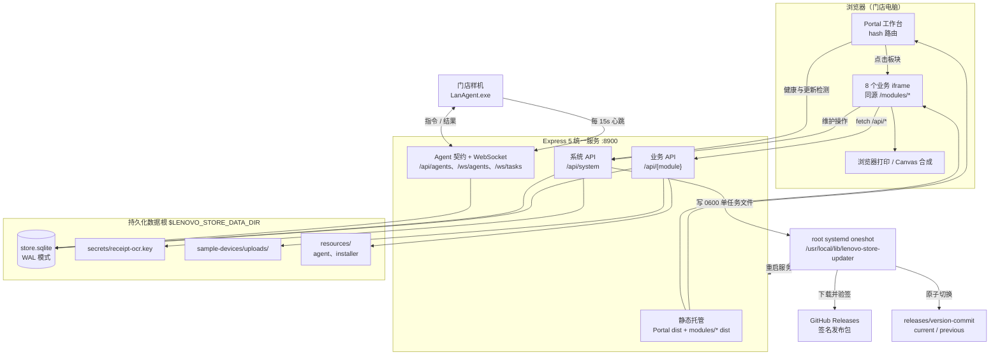
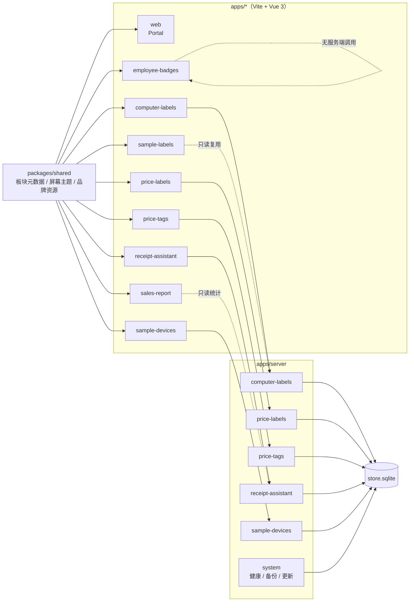
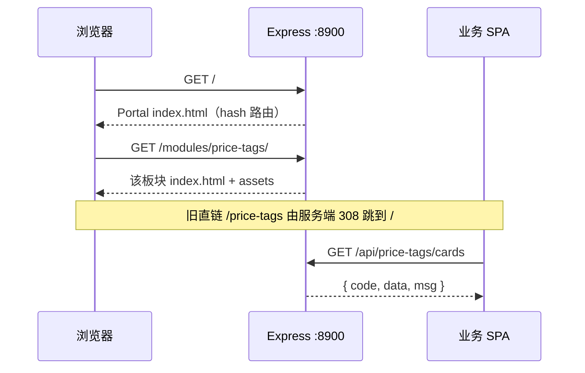
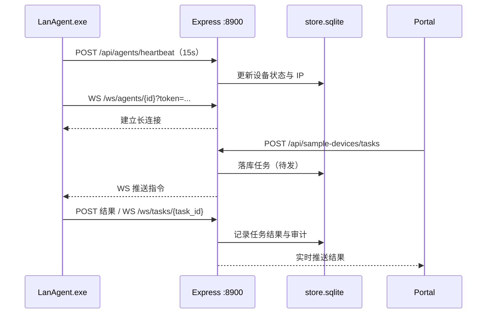
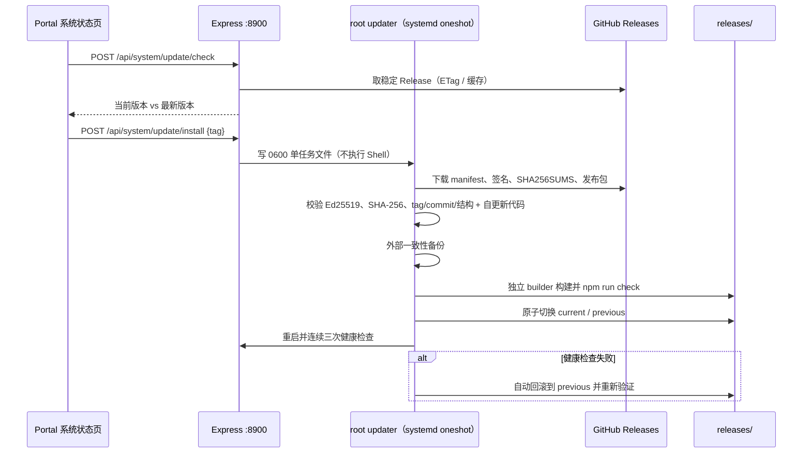

# 架构与交互逻辑

本文说明联想门店运营系统的进程结构、模块边界、请求链路、数据归属和在线更新流程。业务功能清单见 [README](../README.md)，接口细节见 [模块接口](modules.md)，部署与运维见 [Ubuntu 部署指南](ubuntu-deployment.md)。

## 1. 运行时拓扑

一个 Node.js 进程同时承担 Portal 静态托管、8 个业务 SPA 的静态托管、后端 API、样机 Agent 契约与 WebSocket，以及系统维护接口。生产环境只有 8900 一个对外端口。

关键约束：

- **同源**：Portal 通过同源 iframe 加载业务 SPA，不存在跨域调用，也不需要 CORS；维护接口另有严格同源校验。
- **单端口**：样机 Agent 的 HTTP 契约与 WebSocket 复用同一个 `httpServer`，没有独立 Agent 端口。
- **故障隔离**：业务板块之间不共享数据模型，只共享一个 SQLite 文件和一进程一端口。

## 2. 模块分层与数据归属

| 板块 | 前端 | 其后端 | 数据归属 |
| --- | --- | --- | --- |
| 电脑标签打印 | 独立 SPA | `computer-labels` | `computer_*` |
| 外设价签打印 | 独立 SPA | `price-labels` | `price_*` |
| 价格展牌打印 | 独立 SPA | `price-tags` | `pricetag_*`，配件读 `price_products` |
| 付款凭证打印 | 独立 SPA | `receipt-assistant` | `receipt_*` + OCR 密钥文件 |
| 销售业绩报表 | 独立 SPA | `sales-report` | 无自有表，只读 `receipt_sales`、`receipt_sale_items` |
| 样机设备管理 | 独立 SPA | `sample-devices` | `sampledev_*` + 上传目录 |
| 出样标签打印 | 独立 SPA | 无 | 无，只读 `/api/computer-labels/products` |
| 员工工牌制作 | 独立 SPA | 无 | 无，全部状态在浏览器内存 |

## 3. 请求链路

### 3.1 页面加载

- Portal 使用 hash 路由，`#` 之后不发送到服务器，因此刷新永远请求根路径，不依赖反向代理的 SPA rewrite。
- 未知 API 返回 JSON 404，缺失资源与未知页面返回普通 404，不做全局 `index.html` 回退。

### 3.2 打印

打印完全在浏览器侧完成，服务端不参与渲染：

| 板块 | 打印实现 | 尺寸 |
| --- | --- | --- |
| 电脑标签打印 | 独立 `@page` + 毫米布局 | 46mm × 45mm，A4 纵向 24 张/页 |
| 外设价签打印 | 独立字号测量 DOM + `@page` | 70mm × 28mm，A4 横向 28 张/页 |
| 价格展牌打印 | 独立 `@page` + 卡片缩放 | 110mm × 110mm，A4 每页 2 张 |
| 付款凭证打印 | Canvas 合成 → 临时隔离 iframe | A4 单页存根 + 小票 |
| 员工工牌制作 | 隔离 iframe 打印文档 | 54mm × 85mm，A4 横向 5 × 2 |
| 出样标签打印 | 独立 `@page` | A4 横向 3 × 3，每页 9 枚 |

共享主题 `@lenovo-store/shared/theme.css` 只在 `@media screen` 中提供界面样式，不定义 `@page`、不定义共享 `@media print`，因此任何板块的打印规则都不会污染其他板块。销售业绩报表与样机设备管理为纯屏幕展示。

打印分割线等细线一律使用 `border-top` 绘制，不用背景色画线：浏览器默认不打印背景色，且亚像素高度在光栅化时可能被舍成 0。

### 3.3 样机指令下发

只有心跳、没有 WebSocket 长连接时，设备显示在线但指令停留在待发状态。反向代理必须放行 `/ws/agents/` 与 `/ws/tasks/` 的 `Upgrade` 头。

## 4. 数据一致性

- 统一库固定为 `$LENOVO_STORE_DATA_DIR/store/store.sqlite`，使用 WAL 模式、`busy_timeout = 5000`、开启外键约束。
- 表名前缀由 `apps/server/src/db/unified-database.js` 的 `TABLE_PREFIX` 唯一决定，新增持久化模块必须同时登记前缀、备份映射和更新器白名单。
- 在线备份走 SQLite backup API，不能只复制主 `.sqlite` 文件——WAL 中已提交的数据不会进入副本。
- OCR 凭据在库中是密文，只有配套的 `receipt-ocr.key` 或环境密钥能解密。

备份、恢复与迁移的完整流程见 [Ubuntu 部署指南](ubuntu-deployment.md) 第 7、8 节。

## 5. 在线更新链路

Web 服务永不执行 Shell、npm 或 systemctl，只写入受限任务文件；下载、验签、构建、切换、回滚全部在 root-owned oneshot 中完成。发布包安装前会先刷新更新器自身代码，因此更新逻辑的修复随当次升级即刻生效。

版本号规则、发布步骤和镜像配置见 [运维与发布](operations.md)。
